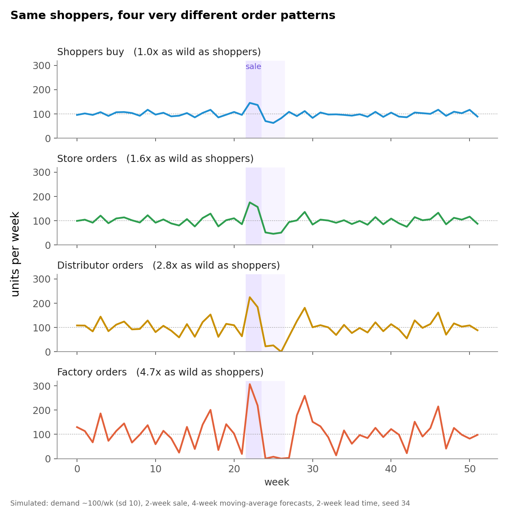
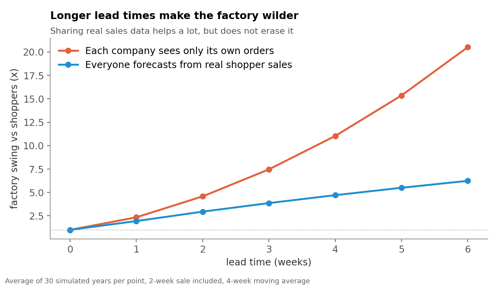
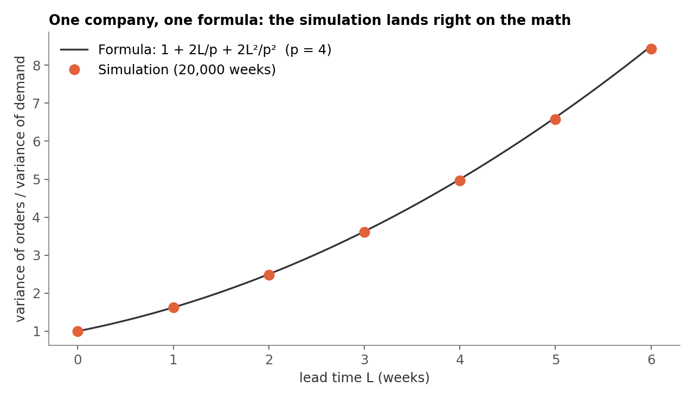

# The bullwhip effect, simulated

A small, honest simulation of why factory orders swing far more than shopper demand.
Companion code for The Network Scientist's video and Medium article.



## Run it

```bash
pip install -r requirements.txt
python bullwhip.py                  # reproduces the numbers in the video
python bullwhip.py --lead-time 4    # longer lead time
python bullwhip.py --share-data     # everyone forecasts from real shopper sales
python bullwhip.py --no-sale        # plain random demand
python make_charts.py               # redraws the three charts
```

Default output:

```
  Shoppers      1.0x as wild as shoppers
  Store         1.6x as wild as shoppers
  Distributor   2.8x as wild as shoppers
  Factory       4.7x as wild as shoppers
```

## The model, in plain words

- **Shoppers** buy about 100 units a week (normal noise, sd 10). A 2-week sale lifts demand 35%, then demand dips 15% for 3 weeks while pantries are full.
- **Store, distributor, factory** each forecast with a 4-week moving average of the orders *they receive*, keep an order-up-to level of `lead time x forecast`, and order enough to get back to it. Lead time is 2 weeks. Orders cannot go below zero.
- **"x as wild"** is the standard deviation of a tier's weekly orders divided by the standard deviation of shopper demand, over the 52 weeks shown.

This is the setup analysed by Chen, Drezner, Ryan & Simchi-Levi (2000). For one company with no safety stock, the variance of orders over the variance of demand is

```
1 + 2L/p + 2L^2/p^2        (L = lead time, p = weeks in the moving average)
```

The simulation matches it (chart 3), which is a useful check that the code does what it says.

| Chart | What it shows |
|---|---|
|  | Factory swing grows fast with lead time. Shared sales data helps but does not remove it. |
|  | One company over 20,000 simulated weeks lands on the formula. |

## Limits (read these)

- Toy model: one product, no capacity limits, no batching, no shortage gaming. Real chains have all of those, so real swings can be bigger.
- The 4.7x depends on the random seed and the sale. Averaged over 30 seeds at a 2-week lead time, the factory is about 4.6x.
- "Swing" in the video is the standard deviation ratio. The formula above is a variance ratio; the swing is its square root.

## Sources

- Lee, H. L., Padmanabhan, V., & Whang, S. (1997). Information Distortion in a Supply Chain: The Bullwhip Effect. *Management Science*, 43(4), 546-558.
- Chen, F., Drezner, Z., Ryan, J. K., & Simchi-Levi, D. (2000). Quantifying the Bullwhip Effect in a Simple Supply Chain: The Impact of Forecasting, Lead Times, and Information. *Management Science*, 46(3), 436-443.

MIT licensed (see the LICENSE file at the top of this repository). The Network Scientist.
