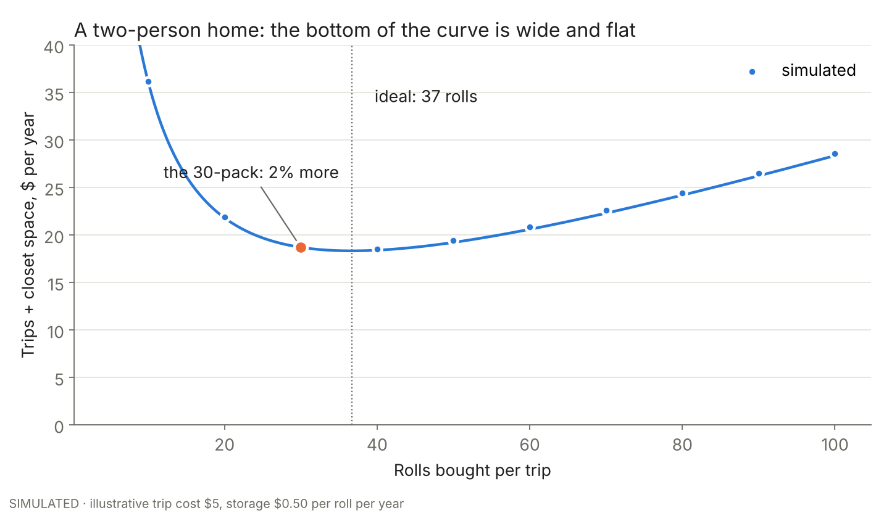
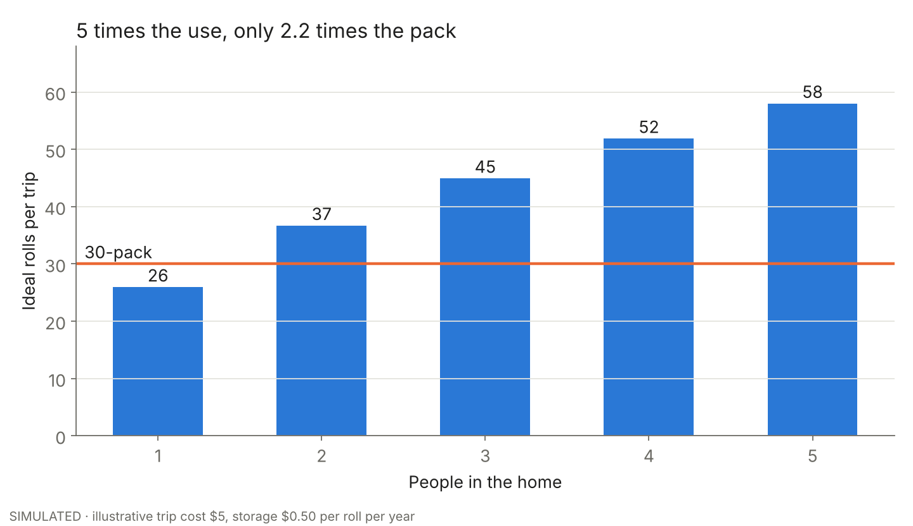
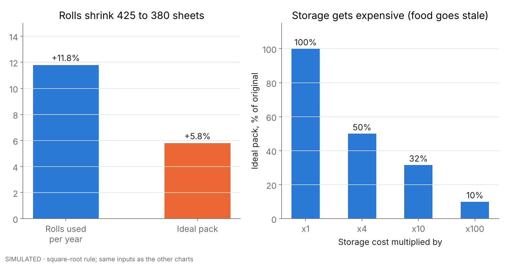

# Economic order quantity, simulated

Why one 30-roll pack of toilet paper fits most homes: every restock trades a trip against shelf space, and the cost of getting that trade "wrong" is surprisingly small. Companion code for The Network Scientist's video and article.







## Run it
```bash
pip install -r requirements.txt
python eoq_model.py       # reproduces the numbers in the video and article
python check_math.py      # formula, simulation and brute force agree
python make_charts.py     # redraws the three charts
```

## The model, in plain words
- One home, one product (toilet paper). Daily use is random, around the home's average.
- Use per person: 35 sheets a day, the estimate from Cottonelle (a toilet paper maker), used as a stated assumption. If a home uses twice that, the best pack for two is about 52 and a 30-pack costs about 15% more. Rolls have 380 sheets (costco.com).
- Each restock trip costs $5 and each roll on the shelf costs $0.50 a year. Both are illustrative.
- When the closet runs out, the home buys a pack of Q rolls.
- The best Q comes from Harris's 1913 square-root formula, Q* = √(2 × trip cost × yearly use / yearly shelf cost per roll). For a two-person home that's about 37.
- "The 30-pack costs about 2% more" means: total yearly trip plus shelf cost at Q = 30, compared with the minimum at Q* (two-person home).
- "Twice the best amount costs 25% more" comes from the formula alone: cost ratio = ½ × (Q / Q* + Q* / Q). It holds for any inputs.

## Checked three ways
1. **Formula:** the square-root rule and the cost ratio.
2. **Simulation:** a day-by-day closet over 500 simulated years for each pack size; costs land within about 1% of the formula.
3. **Brute force:** every pack size from 4 to 100 against the formula cost, and 20 to 55 against the simulated cost. Both find the same best pack.

## Limits (read these)
- The trip and shelf costs are illustrative, so the household numbers (37, 2%) are a demonstration. The 25% rule does not depend on them.
- No price breaks. A cheaper price per roll in bigger packs nudges the best order up.
- One item per trip. Real trips buy many things, which splits the trip cost and pushes each item's best order down.
- No penalty for running out, no spoilage for toilet paper. Food that goes stale behaves like a much higher shelf cost.

## Sources
- Harris, F. W. (1913). How Many Parts to Make at Once. Factory, The Magazine of Management, 10(2), 135-136, 152. Reprinted in Operations Research, 38(6), 947-950 (1990).
- Erlenkotter, D. (1990). Ford Whitman Harris and the Economic Order Quantity Model. Operations Research, 38(6), 937-946.
- Costco Wholesale Corporation, Form 10-K for the fiscal year ended August 30, 2026.
- Costco.com, Kirkland Signature Bath Tissue, 2-Ply, 380 Sheets, 30 Rolls.
- Cottonelle, "How Much Toilet Paper Should You Use?" (usage estimate).

MIT licensed (see the LICENSE file at the top of this repository). The Network Scientist.

