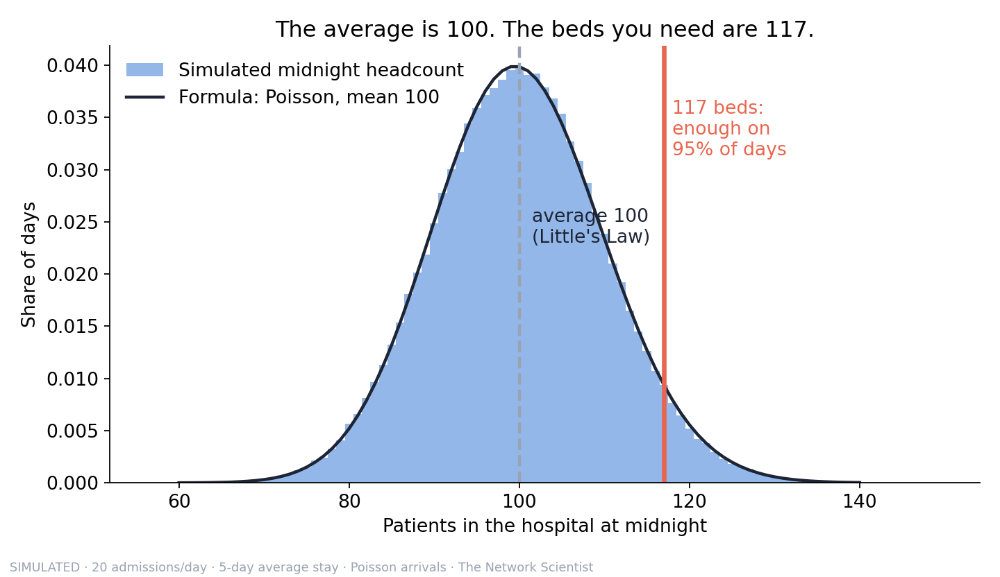
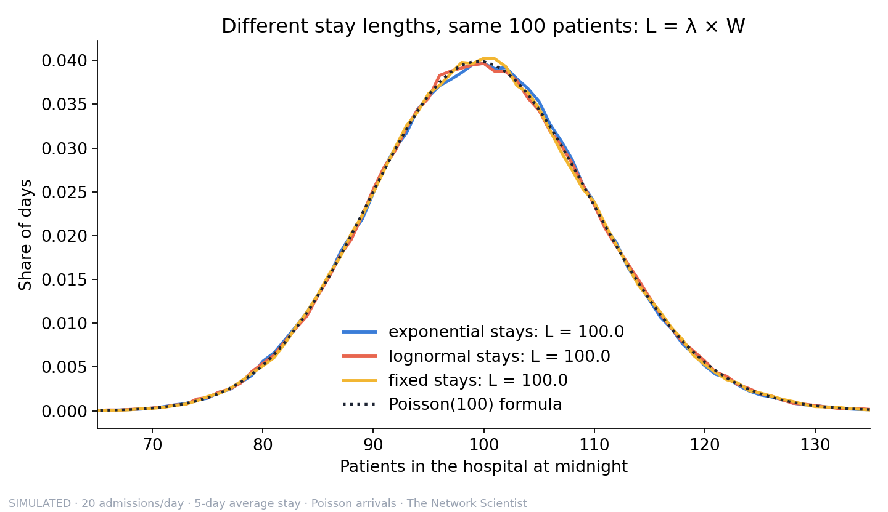
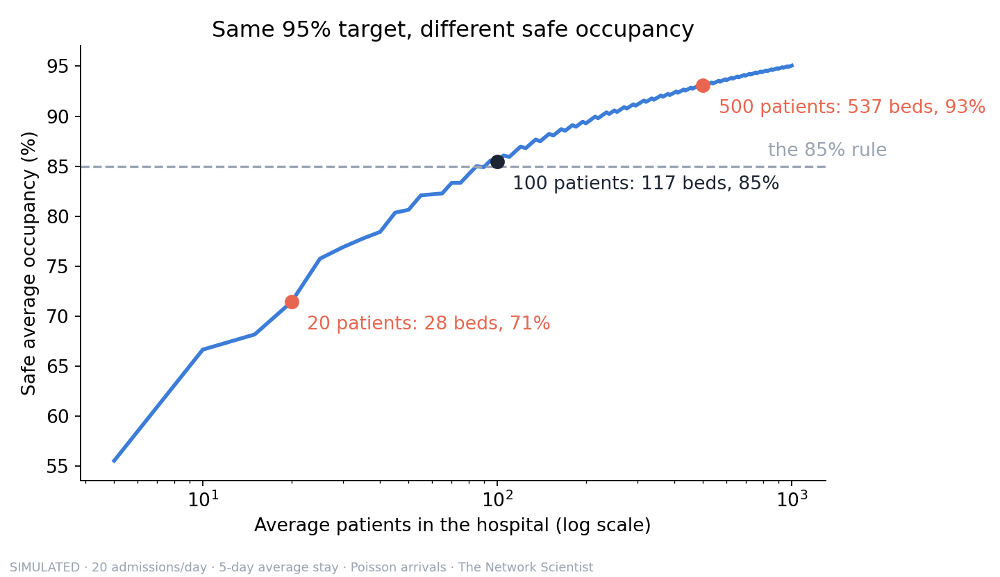
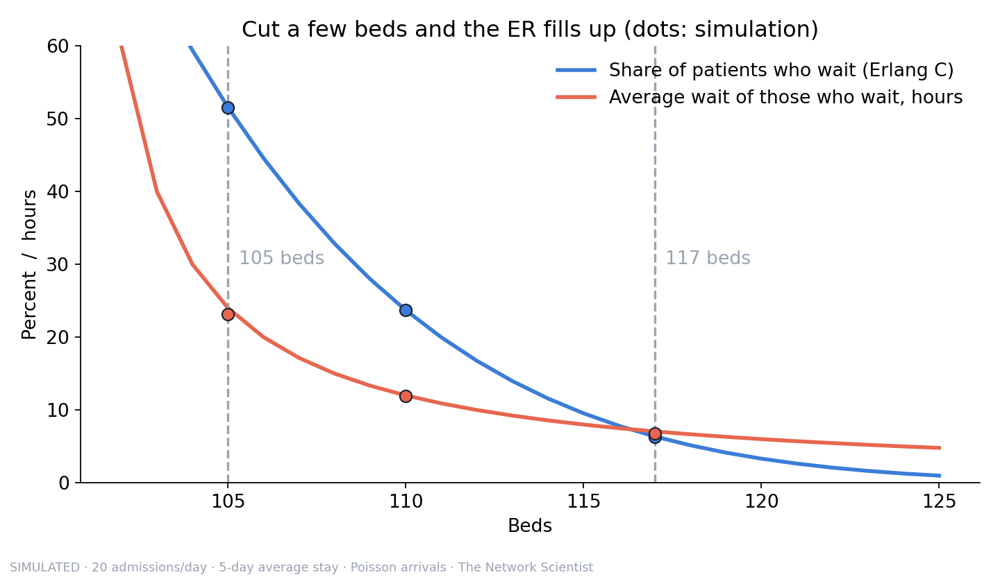

# Little's Law, simulated

How many beds does a hospital need? A discrete-event simulation of a toy hospital, checked against the formulas. Companion code for The Network Scientist's video and article "How Does a Hospital Know How Many Beds It Needs?"









## Run it
```bash
pip install -r requirements.txt
python littles_law.py     # reproduces the numbers in the video and article
python check_math.py      # formula vs simulation vs brute force, prints "All checks passed."
python make_figures.py    # redraws the four charts
```

## The model, in plain words
- Patients arrive as a Poisson process, 20 a day. Many people, each with a small independent chance of needing a bed, add up to Poisson arrivals (the law of rare events).
- Each patient stays a random time with a mean of 5 days. Three shapes are tested: exponential, lognormal (standard deviation 4 days) and a fixed 5 days.
- Little's Law: average patients in the hospital L = arrival rate λ × average stay W = 100.
- With Poisson arrivals and unlimited beds (Kendall notation M/G/∞), the number of patients at any moment is exactly Poisson(λW), whatever the stay distribution. That is the insensitivity result, and fig2 shows it.
- Discrete-event simulation: the clock jumps from event to event (admission, discharge) using a heap of discharge times, instead of ticking in fixed steps.
- Occupancy is counted at midnight, as hospitals do. The first 200 days are discarded (warm-up), then 20,000 days are simulated, 10 times with independent random numbers. Midnight counts are autocorrelated, so replications matter: one short run can say 116 beds when the answer is 117.
- "The number" in the video: 117 beds is the smallest count for which every patient has a bed on 95% of days. Checked three ways: the Poisson formula, the simulated census, and a brute-force search over bed counts.
- The what-if: with a fixed number of beds, patients who find them full wait in the emergency department (boarding), first come first served. With exponential stays this is the M/M/c queue and the Erlang C formula; the simulation also runs lognormal stays.

## Limits (read these)
- One pool of identical beds. Real hospitals split beds into wards that cannot share, so each small ward needs its own cushion; real bed needs are likely higher.
- Discharges here happen at random times. Real discharges cluster in the afternoon and on weekdays, which likely makes boarding worse.
- Boarding patients never leave or transfer, which likely makes the waits look slightly worse than reality.
- The 95% target is a choice, not a standard. The inputs are illustrative, not from any real hospital.
- Little's Law itself has none of these limits: it holds for any stable system. Only the step from the average to a bed count depends on the assumptions.

## Sources
- Little, J. D. C. (1961). A Proof for the Queuing Formula: L = λW. Operations Research, 9(3), 383-387.
- Bagust, A., Place, M., & Posnett, J. W. (1999). Dynamics of bed use in accommodating emergency admissions: stochastic simulation model. BMJ, 319(7203), 155-158.
- Proudlove, N. C. (2020). The 85% bed occupancy fallacy: The use, misuse and insights of queuing theory. Health Services Management Research, 33(3), 110-121.
- Janke, A. T., Burke, L. G., & Haimovich, A. (2025). Hospital "Boarding" Of Patients in the Emergency Department Increasingly Common, 2017-24. Health Affairs.

MIT licensed (see the LICENSE file at the top of this repository). The Network Scientist.

