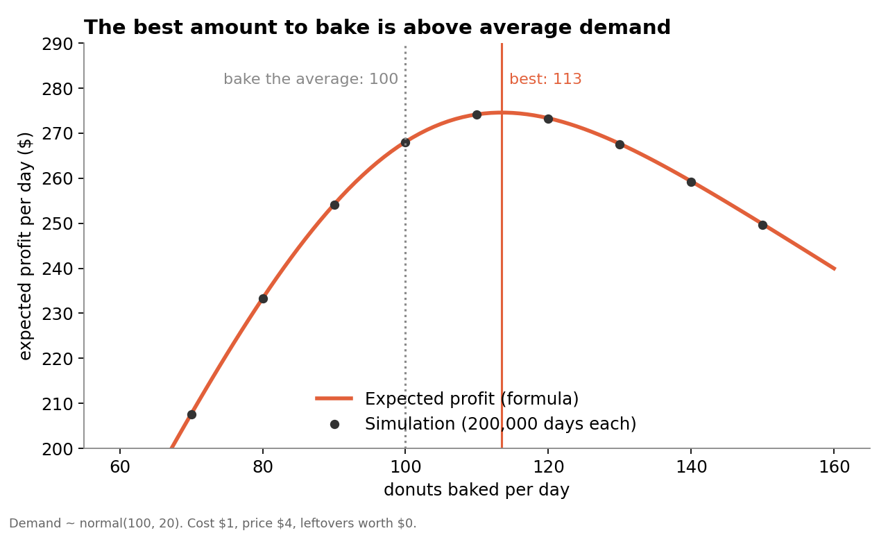
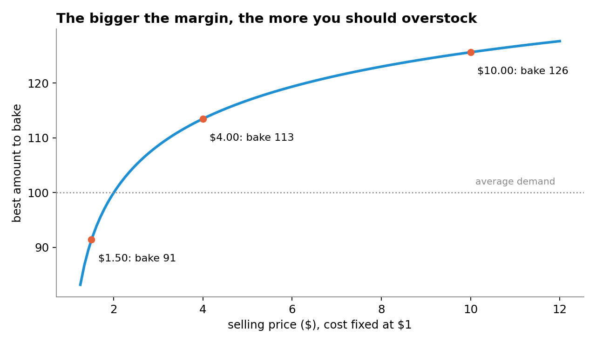
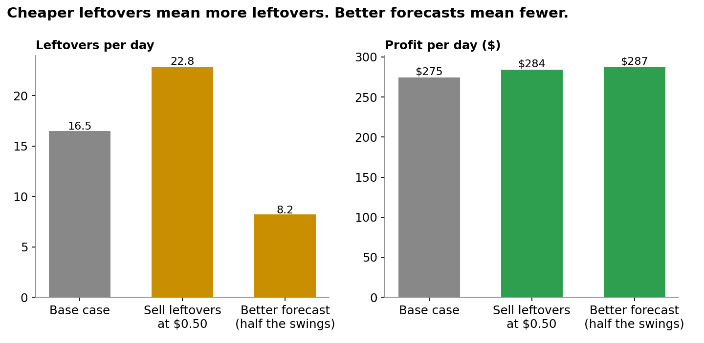

# The newsvendor problem, simulated

How much should a bakery bake when it can't know tomorrow's demand? This folder holds the math, a simulation,
and a three-way check that the two agree. Companion code for The Network Scientist's video and Medium article.



## Run it
```bash
pip install -r requirements.txt
python newsvendor.py                 # base case: cost $1, price $4, demand about 100 a day (sd 20)
python newsvendor.py --price 10      # higher margin
python newsvendor.py --salvage 0.5   # sell leftovers at closing for $0.50
python newsvendor.py --sd 10         # a better forecast: half the uncertainty
python check_math.py                 # formula vs simulation vs brute-force search, for every scenario
python make_charts.py                # redraws the three charts
```

## The math
| Symbol | Meaning | Base case |
|---|---|---|
| D | daily demand (uncertain) | normal, mean mu = 100, sd sigma = 20 |
| Q | how many you bake | you choose |
| c, p, s | cost to make, selling price, value of a leftover | $1, $4, $0 |
| Cu = p - c | cost of a missed sale | $3 |
| Co = c - s | cost of a leftover | $1 |

Best quantity (Arrow, Harris & Marschak, 1951): choose Q* so that

```
P(D <= Q*) = Cu / (Cu + Co)        here 3 / 4 = 0.75
Q* = mu + z * sigma                 z = 0.674 (the 75th percentile of a standard normal)  ->  Q* = 113.5
```

Expected results, with the standard normal loss function L(z) = phi(z) - z(1 - Phi(z)):

```
missed sales  = sigma * L(z)
leftovers     = (Q - mu) + sigma * L(z)
profit        = Cu * mu - [Co * leftovers + Cu * missed sales]
```

## Results (python check_math.py)
| Scenario | Ratio | Q* formula | Q* brute force | Profit formula | Profit simulated | Leftovers | Missed |
|---|---|---|---|---|---|---|---|
| Base case ($4 price) | 75.0% | 113.5 | 113.5 | 274.58 | 274.48 | 16.5 | 3.0 |
| Low margin ($1.50) | 33.3% | 91.4 | 91.5 | 39.09 | 39.09 | 4.4 | 13.0 |
| High margin ($10) | 90.0% | 125.6 | 125.5 | 864.90 | 864.47 | 26.6 | 0.9 |
| Leftovers sold at $0.50 | 85.7% | 121.4 | 121.5 | 284.20 | 284.08 | 22.8 | 1.5 |
| Better forecast (sd 10) | 75.0% | 106.7 | 107.0 | 287.29 | 287.24 | 8.2 | 1.5 |

- Baking the average (100) instead of Q* costs $6.49 a day, about $2,370 a year, for this one product.
- Halving sigma halves the mismatch cost ($25.42 to $12.71 a day): the cost of uncertainty is proportional to sigma.

| | |
|---|---|
|  |  |

## Limits (read these)
- One product, one day, no substitutes, no customer goodwill. Real bakeries also care about regulars and full shelves.
- Demand is assumed normal. With mean 100 and sd 20, the chance of a negative draw is negligible, but other cases may need a different distribution (the critical-ratio rule still holds; only the z step changes).
- Prices and costs are illustrative, not data from any real bakery.

## Sources
- Arrow, K. J., Harris, T., & Marschak, J. (1951). Optimal Inventory Policy. *Econometrica*, 19(3), 250-272.
- Schweitzer, M. E., & Cachon, G. P. (2000). Decision Bias in the Newsvendor Problem with a Known Demand Distribution: Experimental Evidence. *Management Science*, 46(3), 404-420.

MIT licensed (see the LICENSE file at the top of this repository). The Network Scientist.

