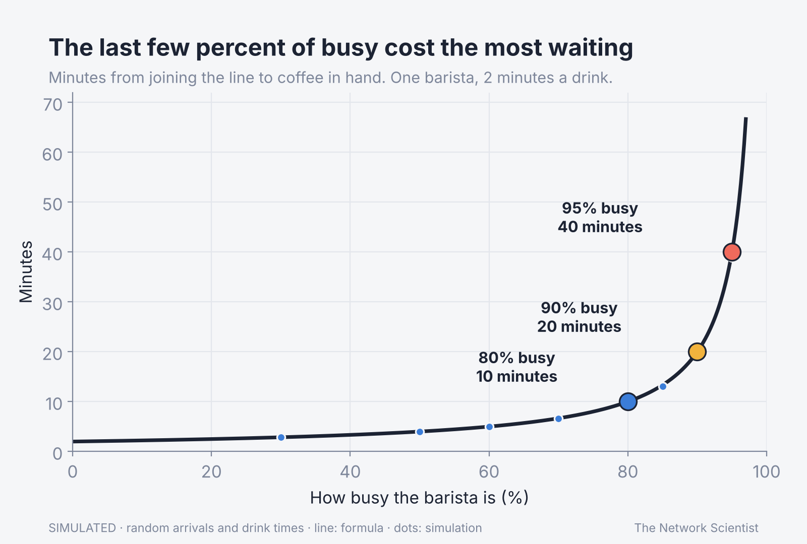
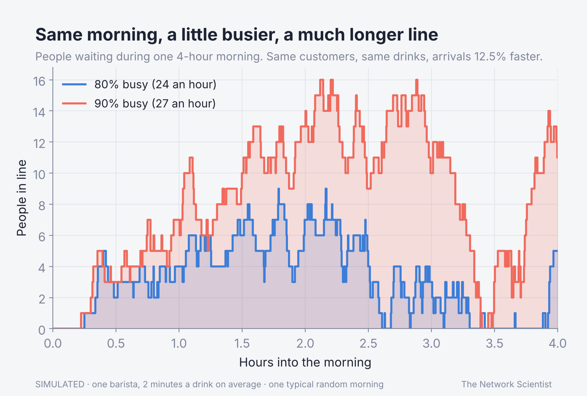
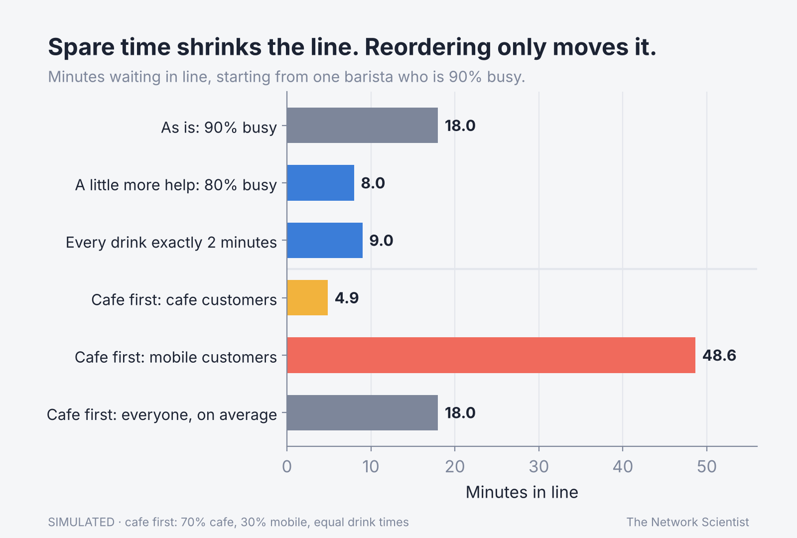
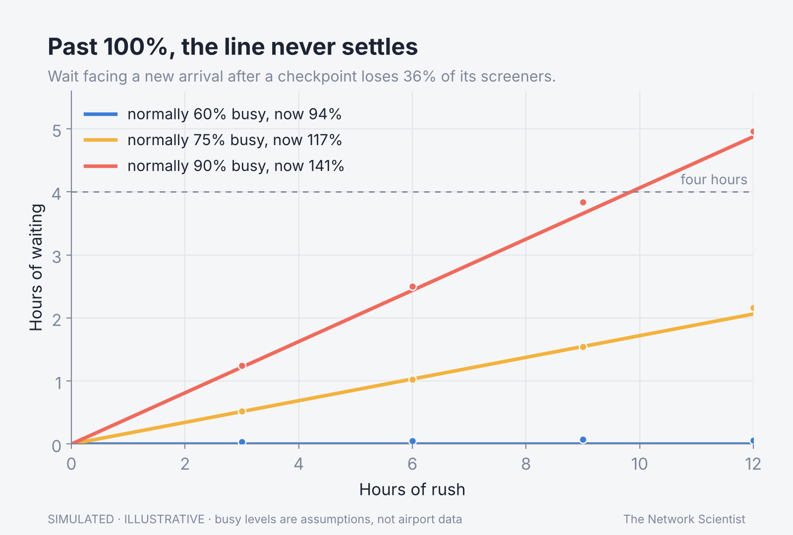

# Queueing and utilization, simulated

Why a line doubles when the server is just a bit busier, checked three ways. Companion code for The Network Scientist's video and article.









## Run it
```bash
pip install -r requirements.txt
python check_math.py      # checks every number three ways; ends with "All checks passed."
python queueing_model.py  # prints every number used in the video and article
python make_figures.py    # redraws the four charts
python make_cover.py      # redraws the article cover
```

## The model, in plain words
- One barista (or two sharing one line). Each drink takes 2 minutes on average.
- Customers arrive at random (a Poisson process). Drink times are random (exponential) unless a run says "steady", where every drink takes exactly 2 minutes.
- "How busy" (utilization) is arrivals per minute times minutes per drink. 80% busy is 24 customers an hour; 90% is 27.
- "Total time" is minutes from joining the line to drink in hand. "Wait in line" leaves out the 2 minutes of drink making.
- Every result is computed three ways: the formula, a customer-by-customer simulation, and the queue's Markov chain solved numerically with no queueing formula.
- The cafe-first example assumes 70% cafe and 30% mobile orders with equal drink times.
- The Houston example: losing 36% of screeners leaves 64% of capacity (exact). The growth numbers assume a checkpoint that is normally 90% busy; that is an illustration, not airport data.

## Limits (read these)
- Nobody leaves the line, and arrivals are steady through the day. Real rushes come and go, and the curve bites hardest inside a rush.
- One or two servers only; real stores and checkpoints have more, which moves the bend later but does not remove it.
- With unequal drink times, putting quick orders first can lower the average wait; the equal-times example cannot show that.
- Simulations average many random runs, so they land within about 2% of the formula, not exactly on it.

## Sources
- Erlang, A. K. (1909). The theory of probabilities and telephone conversations. *Nyt Tidsskrift for Matematik B*, 20, 33-39.
- Cobham, A. (1954). Priority assignment in waiting line problems. *Journal of the Operations Research Society of America*, 2(1), 70-76.
- Kingman, J. F. C. (1961). The single server queue in heavy traffic. *Mathematical Proceedings of the Cambridge Philosophical Society*, 57(4), 902-904.
- Little, J. D. C. (1961). A proof for the queuing formula L = λW. *Operations Research*, 9(3), 383-387.
- Kleinrock, L. (1965). A conservation law for a wide class of queueing disciplines. *Naval Research Logistics Quarterly*, 12(2), 181-192.
- Story facts: Starbucks earnings calls (Oct 2024 to Oct 2025); CBS News (March 2026).

MIT licensed (see the LICENSE file at the top of this repository). The Network Scientist.
