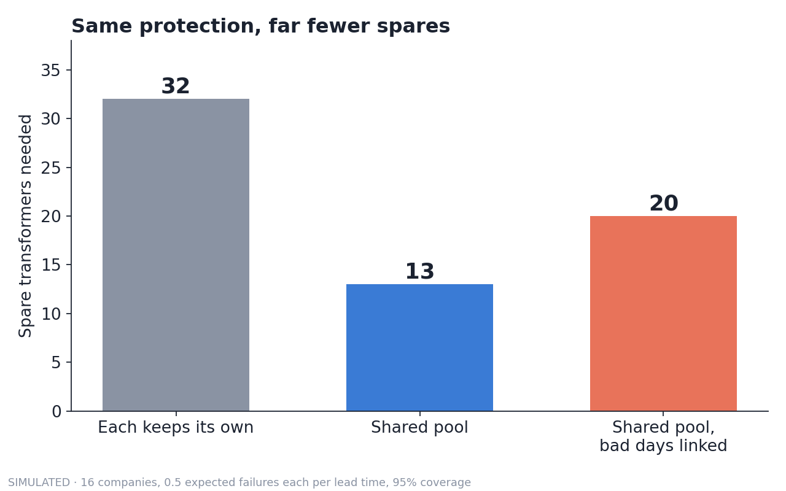
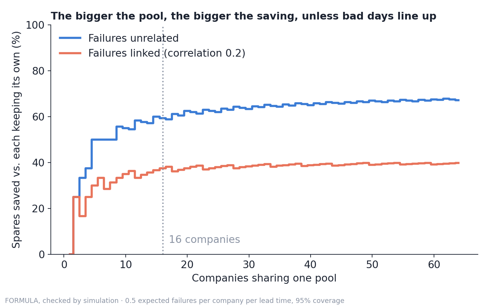
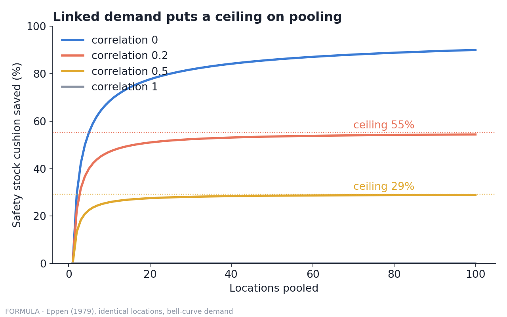

# Safety stock and risk pooling, simulated

Why one shared pool of spare parts needs far fewer spares than many private stockpiles, and how linked bad days shrink the saving. Companion code for The Network Scientist's video and article, *Why Sharing Spare Parts Beats Hoarding Them* (on Substack, also on Medium).







## Run it
```bash
pip install -r requirements.txt
python risk_pooling.py     # reproduces every number in the video and article
python make_figures.py     # redraws the three charts
python check_math.py       # formula vs simulation vs brute force; ends with "All checks passed."
```

## The model, in plain words
- 16 power companies. While a replacement transformer is being built, each expects 0.5 failures on average. This rate is illustrative, not real utility data.
- Failures are counted with a Poisson distribution (the standard model for rare, random events).
- Each company wants to be covered 95% of the time: no more failures than spares.
- "Each keeps its own": every company holds enough for itself. "Shared pool": one stock covers all 16.
- Linked version: a shared "bad stretch" factor (gamma distributed, average 1, variance 0.5) multiplies every company's failure rate at once, giving a correlation of 0.2 between any two companies.
- The numbers: 2 spares each (32 in total) versus 13 pooled, a 59% saving. Linked: 20 pooled, a 38% saving. Each is computed three ways: exact quantiles, a million simulated lead times, and a brute-force search for the smallest whole number of spares that hits 95%.
- Figure 3 is the general rule for large, steady items with bell-curve demand (Eppen, 1979): pooling n locations with correlation ρ shrinks the cushion by √(1/n + (n − 1)ρ/n), so the saving can never exceed 1 − √ρ.

## Limits (read these)
- Spares are treated as identical and instantly movable. Real transformers are often custom and cost hundreds of thousands of dollars to move, which makes real pooling harder and the saving smaller.
- The failure rate is known and fixed here; in reality it is estimated, which adds uncertainty and pushes the needed spares up.
- One simple form of correlation is used. Stronger links in a crisis would push the pooled number higher.
- Treat the numbers as a demonstration of the mechanism, not a plan for any real utility.

## Sources
- Eppen, G. D. (1979). Note: Effects of Centralization on Expected Costs in a Multi-Location Newsboy Problem. *Management Science*, 25(5), 498-501. https://doi.org/10.1287/mnsc.25.5.498
- US GAO (2023). *Electricity Grid: DOE Could Better Support Industry Efforts to Ensure Adequate Transformer Reserves* (GAO-23-106180). https://www.gao.gov/products/gao-23-106180

MIT licensed (see the LICENSE file at the top of this repository). The Network Scientist.

